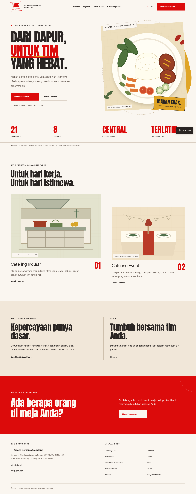

# Website UBG Catering — versi pembangunan ulang

Source website berada di **company-profile**, Studio resmi Sanity di **sanity-studio**. File index.html di root adalah aplikasi invoice lama dan tidak diubah atau termasuk website. Ini pembangunan ulang setelah lingkungan sebelumnya tidak tersedia; hasil pengujian lama tidak dianggap pengujian versi ini.

## Preview desain



[Tampilan mobile](company-profile/docs/preview/beranda-mobile.png) · [Source branch](https://github.com/sunanoedi/PurchaseMBG/tree/main)

## Menjalankan website

Gunakan Node.js **24.x** dan npm. Dari root repository:

```bash
cd company-profile
npm ci --no-audit --no-fund
npm run dev
```

Website menggunakan konten cadangan tanpa konfigurasi Sanity. Kolom formulir tetap bisa diisi tanpa konfigurasi layanan. Pengiriman email sengaja nonaktif tanpa seluruh konfigurasi Turnstile/Resend/Upstash; tautan WhatsApp dan email tersedia sebagai alternatif. Jangan memasukkan data pelanggan untuk pengujian. Logo, ilustrasi, teks sambutan dan profil adalah draf yang perlu persetujuan manusia.

Build produksi lokal:

```bash
npm test
npm run build
npm run typecheck
npm start
```

## Deploy demo ke Vercel

1. Buka Vercel, pilih Add New Project, lalu impor sunanoedi/PurchaseMBG.
2. Source website sudah masuk ke **main** melalui PR #1. Gunakan main sebagai Production Branch. Tinjau dan merge PR perbaikan berikutnya untuk memperbarui deployment; pastikan integrasi Git Vercel memakai branch yang sama.
3. **Root Directory: company-profile**, Framework Next.js, Node.js24.x. Jangan deploy root repository/index.html. Biarkan Output Directory bawaan; jangan static export/out.
4. Install/build mengikuti company-profile/vercel.json: frozen npm ci, tes, build dan typecheck.
5. Untuk demo awal, environment boleh kosong. Website memakai /content dan form tidak mengirim. Pilih paket hosting yang sesuai penggunaan komersial dan batasi biaya.
6. Setelah deploy sukses, gunakan URL asli dari dashboard Vercel. Canonical/hreflang tetap ubg.id; demo belum boleh dianggap website produksi yang disetujui.
7. Untuk produksi, lengkapi environment, identitas/aset, bukti klaim, privacy, akun dan seluruh checklist docs sebelum menghubungkan domain.

HTML dirender **dinamis** untuk nonce CSP unik, sesuai persetujuan sebelumnya. Tidak menggunakan ISR/static export untuk HTML. Data CMS published dapat di-cache60detik dan dibatalkan webhook HMAC; ini berbeda dengan cache HTML. Jangan memakai cache-everything atau menambahkan CSP bertentangan di proxy.

## Integrasi dan panduan

- [Environment lengkap](company-profile/docs/ENVIRONMENT.md)
- [Admin Sanity](company-profile/docs/ADMIN-SANITY.md)
- [DNS, produksi dan go-live](company-profile/docs/DEPLOY.md)
- [Audit versi baru](company-profile/docs/AUDIT.md)
- [Perintah verifikasi](company-profile/docs/VERIFIKASI.md)
- [Pemeliharaan bulanan](company-profile/docs/PEMELIHARAAN.md)
- [Cek Lolos dan keputusan](company-profile/docs/STATUS.md)

Tidak ada akun, pembayaran, DNS, email nyata atau deployment provider yang dibuat hanya dengan menyimpan source ini. Jangan kirim secret melalui chat; masukkan langsung ke panel environment aman. Backup repository dan backup konten Sanity adalah dua hal berbeda.
